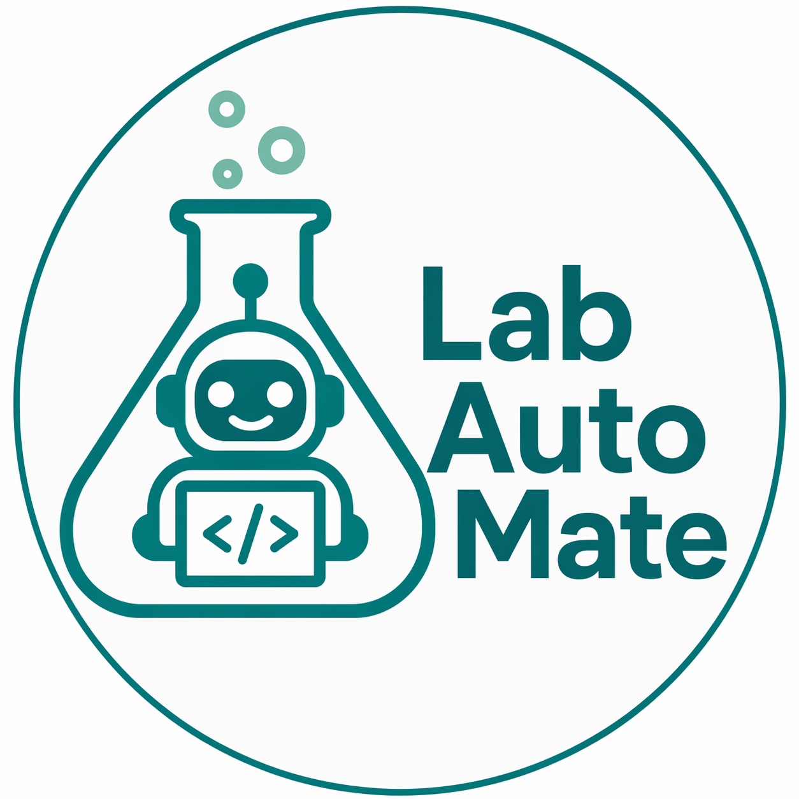

<p align="center">
  
</p>

<h1 align="center">LabAutoMate</h1>

<p align="center">
  <em>An Augmented Language Model for Chemistry Lab Automation via Python</em>
</p>

<p align="center">
  
  
  
  
  
</p>

---

## Overview

LabAutoMate is an AI-powered chatbot that generates Python code for chemistry laboratory automation. It leverages large language models (OpenAI, Anthropic Claude) combined with a structured prompt strategy to produce:

- **New instrument drivers** from PDF communication manuals
- **Automation scripts** for experimental workflows
- **Dash/Plotly web applications** for real-time laboratory instrument monitoring and control

The chatbot uses the [PyLabDrivers](https://github.com/MSDLLCpapers/PyLabDrivers) package as its reference library of 20 validated instrument drivers.

---

## Quick Start

**Option 1 — Double-click (recommended):**
```
launch.bat
```
The launcher automatically installs [uv](https://github.com/astral-sh/uv), creates an isolated virtual environment, installs all dependencies, and starts the app. Works on any Windows machine with no prior setup.

**Option 2 — Manual:**
```bash
pip install -r requirements.txt
pip install -e ../PyLabDrivers    # optional: editable install
streamlit run app.py
```

Configure your API key and model in the sidebar.

---

## Features

| Feature | Description |
|---------|-------------|
| **Multi-Provider LLM** | OpenAI GPT-4.1, Anthropic Claude — all via unified interface |
| **Driver Generation** | Upload a PDF manual → AI generates a PyLabDrivers-compatible driver |
| **Automation Scripts** | Describe an experiment → AI writes the full automation workflow |
| **Dash App Generation** | 4-step workflow: Specification → Review & Design → Generate & Fix → Export |
| **Structured Prompts** | 5-section template reduces hallucination and improves code quality |
| **Flow Diagram** | AI generates interactive Vis.js flowcharts of the automation logic |
| **UI Mockup** | AI produces a professional HTML/CSS mockup of the Dash app layout |
| **Design Refinement** | Plain-English chat to update workflow and layout before generating code |
| **Code Verification** | Static analysis + AI review + automated test generation |
| **Iterative Fix** | Quick Fix (surgical patch) or Full Rewrite from error messages |
| **Export Package** | Download everything as ZIP: app code, README, launch.bat, diagram |
| **uv-based Launcher** | Generated Dash apps include their own launch.bat using uv |

---

## Supported LLM Providers

| Provider | Models | Auth |
|----------|--------|------|
| **OpenAI** | GPT-4.1, GPT-4.1-mini, GPT-4o, GPT-4o-mini | API key |
| **Anthropic** | Claude Sonnet 4.6, Claude Opus 4.6, Claude Sonnet 4.5, Claude Haiku 4.5 | API key |

---

## Workflow

### Tab 1: Driver & Script Generation

```
Upload PDF Manual → Extract Text → Write Structured Prompt → Generate → Verify → Download
                                                                ↑                    |
                                                                └── Fix with AI ←────┘
```

### Tab 2: Dash Web Application Generation

```
1. Specification   →  Write prompt, select reference drivers
2. Review & Design →  Edit Automation Workflow + Dashboard Layout Plan
                      Generate Flow Diagram (Vis.js) + UI Mockup (HTML/CSS)
                      Refine with plain-English chat
3. Generate & Fix  →  Generate Dash app, Quick Fix or Full Rewrite from errors
4. Export          →  Download ZIP: dash_app.py + README + launch.bat + diagram
```

---

## Structured Prompt Strategy

Every prompt follows a 5-section template to minimize hallucination:

| Section | Purpose |
|---------|---------|
| **1. Project Overview** | What instrument/experiment, objectives, key components |
| **2. User Interface Design** | Layout, buttons, inputs, plots, dropdowns |
| **3. Functionality and Logic** | Operational sequences, formulas, state transitions |
| **4. Technical Implementation** | Code structure, callback IDs, threading, error handling |
| **5. Documentation and References** | Manual pages, protocols, external libraries |

---

## Requirements

```
streamlit>=1.30.0
openai>=1.0.0
anthropic>=0.40.0
pymupdf>=1.24.0
numpy
pandas
python-dotenv
```

PyLabDrivers (companion package): `pip install -e ../PyLabDrivers`

---

## Configuration

Copy `.env.example` to `.env` and fill in your credentials:

```env
LABAUTOMATE_API_KEY=your-api-key-here
LABAUTOMATE_ENDPOINT=https://api.openai.com/v1
```

Or configure everything in the Streamlit sidebar at runtime (provider, model, API key, endpoint).

**Endpoints:** use your own API key with the provider's public URL:
- OpenAI: `https://api.openai.com/v1`
- Anthropic: `https://api.anthropic.com`

If the endpoint does not match the selected provider (for example the OpenAI URL while Anthropic is selected), the provider's public URL is used. Another URL is passed to the provider's SDK as its base URL, so it must speak the same API (OpenAI Chat Completions or Anthropic Messages). Model names must be the ones your provider accepts.

**Model not in the dropdown?** Open **Import a model not listed** in the sidebar, paste one or more model ids (comma, space or new-line separated) or the JSON returned by your provider's model-list endpoint, and click **Add to model list**. The ids are added to the Model dropdown for the selected provider and are sent to the provider exactly as typed. Imported models last for the current browser session.

---

## Examples

The `examples/` folder contains four generated applications from the paper:

| Example | Description |
|---------|-------------|
| `example1_multi_pump_dash_app.py` | Dash app controlling 4 lab pumps (ISCO, Reaxus, Knauer, Harvard) |
| `example2_reaxus_ld_driver.py` | AI-generated driver for Teledyne ReaXus LD-Class from PDF manual |
| `example3_pat_uvvis_ir_raman_app.py` | PAT dashboard for UV-Vis + ReactIR + ReactRaman |
| `example4_dynamic_flow_automation.py` | Automated dynamic flow experiment with sample collection |

---

## Third-Party Vendor Files

Some instruments need vendor software that is not redistributed here:

- **Vapourtec R-Series:** obtain the `rseriesopc` Python API and its example scripts from [Vapourtec Ltd](https://www.vapourtec.com). Copy the example scripts into `reference_examples/vapourtec/` to use them as reference context (see the [README](reference_examples/vapourtec/README.md) there).
- **Huber Pilot ONE (pySoftcheck):** download the [pySoftcheck wheel](https://www.huber-usa.com/fileadmin/user_upload/huber-online.com/Downloads/Software/pysoftcheck-3.0.0-py3-none-any.whl) and [documentation](https://www.huber-online.com/fileadmin/user_upload/huber-online.com/download_center/Betriebsanleitungen/Documentation_pySoftcheck.pdf) from [Huber](https://www.huber-online.com). Place the `.whl` file next to `launch.bat` and the launcher installs it.
- **Ocean Optics OceanDirect SDK:** the `oceanoptics.py` wrapper used in Example 3 (in `reference_examples/oceanoptics/`) requires the OceanDirect SDK, which Ocean Optics supplies with the instrument and which is not redistributed here. After installing it, place the `oceandirect` folder next to the generated `dash_app.py`, together with `oceanoptics.py`, so the app can import both.

---

## License

MIT License — see [LICENSE.txt](LICENSE.txt)
